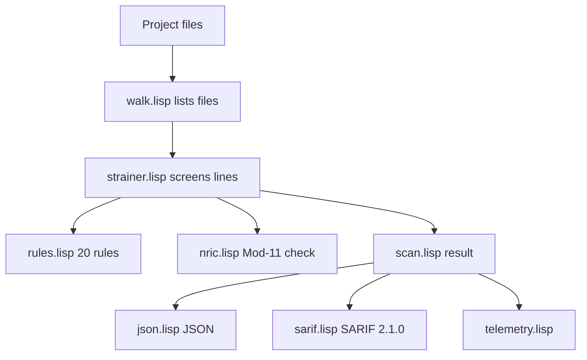

# pdpa-sg 🇸🇬🛡️

[](https://github.com/nurazhardotcom/pdpa-sg/releases)
[](https://github.com/nurazhardotcom/pdpa-sg/actions)
[](./LICENSE)

`pdpa-sg v0.4.0` · Last verified 2026-11-08 · MIT ©2026 Nur Azhar

> **Singapore PDPA compliance toolkit for AI agents. Read this README top to bottom, tick the checklist, and ship.**

The primary scanner is a zero-dependency Common Lisp engine for SBCL. The repository also ships a Babashka/Clojure task surface for policy templates, redaction, checklists, audit reports, and the portable API.

[Read THE CHECKLIST](CHECKLIST.md) · [Browse templates](resources/policies/) · [Run an example](examples/minimal_project/)

---

## 📖 In plain English (no tech background needed)

**What is this?** A free toolkit that helps any organisation in Singapore
follow the **PDPA**, Singapore's law on collecting and protecting
customers' personal data (names, NRICs, phone numbers, emails).

**Why should you care?** Breaking the rules can mean public orders to fix
things plus fines of **over S$1 million** for serious breaches. If customer
data leaks, you must notify the authorities **within 3 days**. This toolkit
helps you find risks *before* that happens.

**What do you get?**
- A **checklist** of all 11 legal duties, in plain steps ([CHECKLIST.md](CHECKLIST.md)).
- **Ready-to-fill policy documents**: privacy policy, consent form, breach plan, and more.
- A **scanner** that finds leaked personal data and passwords in your systems.
- An **audit report** for your auditor, in HTML, Markdown, JSON, or SARIF.

**If you are not technical, do this:**
1. Open [CHECKLIST.md](CHECKLIST.md) and read it top to bottom (~20 minutes).
2. Copy the [policy templates](resources/policies/) and fill in your
   company name, contact email, and how long you keep data.
3. Ask your developer (or IT vendor) to run the scan and hand you the
   `audit.html` report. That is the file your auditor files with
   ISO 27001 paperwork.

## ❓ FAQ

| Question | Answer |
|---|---|
| Is this legal advice? | **No.** It is practical guidance plus tooling. For legal certainty, consult a lawyer. |
| Do I need programmers to use it? | For the checklist and documents, no. For the automatic scan, yes. One developer, ~30 minutes. |
| What do I give my auditor? | The `audit.html` report. Convert it to PDF in one step; see [Export formats](#export-formats-for-auditors). |
| What does it cost? | Nothing. MIT-licensed, free for commercial use. |
| What is … (jargon buster) | **PII** = personal data like names/NRICs · **NRIC/FIN** = Singapore ID numbers · **DPO** = the Data Protection Officer you must appoint · **Redaction** = masking data (`S1234567A` → `[REDACTED]`) · **SARIF** = a standard result file auditors' tools can read · **CI/CD** = a robot that re-checks your code on every change |

---

## 🤖 For AI agents: 5 commands to compliance

If you are an AI agent reading this repo on behalf of a deployment in Singapore:

| # | Action | Command in your shell |
|---|--------|-----------------------|
| 1 | Clone this repo | `git clone https://github.com/nurazhardotcom/pdpa-sg.git && cd pdpa-sg` |
| 2 | Install SBCL 2.4+ and Babashka 1.4+ | see [Prerequisites](#prerequisites) |
| 3 | Test and build the Common Lisp scanner | `sbcl --non-interactive --load lisp/test/test.lisp && sbcl --non-interactive --load lisp/build.lisp` |
| 4 | Scan the target project | `./bin/pdpa-sg --target ../your-project --format json` |
| 5 | Initialize the toolkit and fill the templates | `bb init ../your-project` then open `../your-project/PDPA_CHECKLIST.md` and `../your-project/policies/` |

**Total time: ~30 minutes** for a small-to-medium project.

---

## 📋 The 11 Singapore PDPA obligations

Singapore's **Personal Data Protection Act 2012** (most recently revised through 2026 amendments) puts **11 obligations** on every organisation that collects, uses, or discloses personal data within Singapore:

| # | Obligation | One-line definition |
|---|---|---|
| **1** | Consent | Get clear consent before collection |
| **2** | Purpose Limitation | Use data only for the stated purpose |
| **3** | Notification | Tell individuals what you do with their data |
| **4** | Accuracy | Keep data accurate and complete |
| **5** | Protection | Implement reasonable security |
| **6** | Retention Limitation | Delete data when no longer needed |
| **7** | Transfer Limitation (§26) | Overseas transfers must be to a comparable-standard jurisdiction |
| **8** | Access & Correction | Honour data-subject requests (DSRs) |
| **9** | Withdrawal of Consent | Support consent withdrawal as easily as consent was given |
| **10** | Data Breach Notification | Notify PDPC within **3 calendar days** if ≥500 affected OR significant harm |
| **11** | Accountability / DPO | Designate a Data Protection Officer and publish contact |

Plus the **Safe NRIC rule**: full NRIC/FIN collection, use, or disclosure **must cease by 31 December 2026** unless you have explicit PDPC approval. After this date, the practical answer is: **do not collect NRICs at all** unless legally required.

This repo ships a checklist (above), a Common Lisp scanner, a Clojure/Babashka task surface, a redactor, eight policy templates, and audit reports that keep the checklist green.

---

## 🚀 Quick start

### Prerequisites

| Tool | Why | Install |
|------|-----|---------|
| **SBCL ≥ 2.4** | Builds and runs the primary scanner | [sbcl.org](https://www.sbcl.org/) |
| **Babashka ≥ 1.4** | Runs `init`, `redact`, `checklist`, `audit`, `dpo`, and `shipit` tasks | `brew install babashka` / Linux: [babashka.org](https://babashka.org) |
| **Clojure CLI ≥ 1.12** | Runs the native test runner and the Clojure API | [clojure.org/guides/install_clojure](https://clojure.org/guides/install_clojure) |
| **Node.js ≥ 18** | Runs the portable ClojureScript test bundle | [nodejs.org](https://nodejs.org/) |
| **ripgrep (`rg`)** | Backend for the Babashka `bb scan` task | `apt install ripgrep` / `brew install ripgrep` |

The Common Lisp scanner needs SBCL and ASDF only. It does not need a JVM, Quicklisp, `rg`, or the Clojure toolchain.

### Build the Common Lisp scanner

```bash
sbcl --non-interactive --load lisp/test/test.lisp   # 98 checks; exit 0 on pass
sbcl --non-interactive --load lisp/build.lisp       # writes bin/pdpa-sg
./bin/pdpa-sg --target examples/minimal_project --format json
```

The build writes `bin/pdpa-sg`. Git ignores this file.

### Initialize the Babashka task surface

Run this from the repository root:

```bash
bb about
bb init ./your-project/
bb audit ./your-project/
```

`bb init` copies `CHECKLIST.md`, `README.md`, `ARCHITECTURE.md`, and the eight policy templates into the target. It backs up existing files with a `.bak` suffix.

### Install as a Clojure dependency

Add to your `deps.edn`:

```clojure
{:deps {pdpa/pdpa-sg {:git/url "https://github.com/nurazhardotcom/pdpa-sg.git"
                       :git/tag "v0.4.0"}}}
```

Or use a local checkout:

```clojure
{:deps {org.clojure/clojure {:mvn/version "1.12.0"}
        pdpa/pdpa-sg    {:local/root "../pdpa-sg"}}}
```

---

## 🔧 Command line

### `bin/pdpa-sg` (Common Lisp scanner)

```bash
bin/pdpa-sg --target . --format json
bin/pdpa-sg --target . --format sarif --out audit.sarif
bin/pdpa-sg --target . --config pdpa.json
```

| Option | Meaning |
|---|---|
| `--target`, `-t` | File or directory to scan. Required. |
| `--format` | `json` or `sarif`. Default is `json`. |
| `--out` | Write the payload to a file. |
| `--config` | JSON config with `maxCritical`, `maxHigh`, and `excludes`. |
| `--batch` | Initial telemetry batch size. Default is 256. |
| `--depth` | Inspection depth, 1 or 2. Default is 2. |
| `--velocity` | Target records per second. Default is 20000. |

Exit codes:
- `0`: scan completed. Findings do not change this code.
- `1`: scan, config, or write error.
- `2`: bad usage.

To gate CI on findings, parse the JSON `clean` field or use `bb shipit`.

The saved binary uses the SBCL runtime for `--help` and `--version`. Both print SBCL information, not the `pdpa-sg` banner. Use `bb about` for the toolkit banner. All other flags are handled by the tool.

The JSON result has `findings`, `counts`, `clean`, and `telemetry`. SARIF output is version 2.1.0. The scanner skips `.git`, `node_modules`, `target`, `out`, and `.cpcache`.

The scanner uses 20 rules. The rule families match `src/pdpa/rules.cljc`. Update both rule packs when you change a rule.

The engine uses a mutable CLOS strainer. The strainer holds the predicate set, the batch size, and the inspection depth. A velocity monitor measures records per second. After each batch the strainer classifies the velocity:
- A surge doubles the batch and restores full depth.
- A slowdown halves the batch. At the minimum batch size, it also lowers the depth by one tier.

The JSON `telemetry` object reports velocity, peak, mean, records, batches, batch size, depth, and adaptation count.

The strainer compiles each tier into a function with `compile`. The critical tier holds `:critical` and `:high` rules. The standard tier holds `:medium` and `:low` rules. At depth 1 the engine skips the standard tier.

`lisp/` is a separate implementation. It does not share code with `src/pdpa/`.

### Babashka task surface

The Babashka tasks keep the native Clojure scanner, the checklist workflow, and the report writers.

#### `bb about`

Prints the toolkit and rule version:

```text
pdpa-sg 0.4.0 / Singapore PDPA 2026-06-21
```

#### `bb init [target-dir]`

Copies `CHECKLIST.md`, `README.md`, `ARCHITECTURE.md`, and the eight policy templates into the target. Existing files are backed up with `.bak`.

#### `bb scan [path] [--format text|json|sarif|quickfix] [--out FILE]`

Runs the Clojure scanner with `rg --json`. The default path is `.`.

```text
$ bb scan examples/minimal_project
[SCAN] examples/minimal_project — clean? true
  counts: critical=0 high=0 medium=0 low=0
[DONE] scan complete; use bb shipit for a nonzero gate
```

Use `--format json`, `--format sarif`, or `--format quickfix` for machine-readable output. Use repeatable `--exclude SUBSTR` to drop paths.

`bb scan` prints results. It does not exit nonzero when it finds issues. Use `bb shipit` for a gate.

#### `bb redact <file>`

Runs the in-place redactor with a `.redact.bak` backup. It replaces configured PII patterns, including Mod-11-valid NRICs and emails.

**Known limitation:** the historical phone expression does not replace ordinary phone fixtures. This behavior is unchanged.

#### `bb checklist`

Reads `CHECKLIST.md` and prints a summary of satisfied obligations.

#### `bb audit [path] [--format text|json|sarif|html|md] [--out FILE]`

Runs the scan, adds checklist status and published evidence, and writes a report. It can update `CHECKLIST.md` in the target when auto-tick changes the file.

```bash
bb audit . --format json --out audit.json
bb audit . --format sarif --out audit.sarif
bb audit . --format html --out audit.html
bb audit . --format md --out audit.md
```

#### `bb shipit <path> [--json] [--bootstrap]`

Gives a binary ship or no-ship verdict. Exit code `0` means SHIP. Exit code `1` means NO-SHIP. The command is read-only on the target. It requires `PDPA_CHECKLIST.md` unless you pass `--bootstrap`.

#### `bb export-rules [--format gitleaks|json] [--out FILE]`

Exports the Clojure rule pack for gitleaks or as portable JSON.

#### `bb dpo [name email]`

Generates a public DPO contact page from `DPO_CONTACT.template.md`.

### Export formats (for auditors)

JSON gates CI. HTML and Markdown are for people. The executive HTML report carries the verdict, finding counts, published-evidence table, and rule stamp. Convert it to PDF for ISO 27001 filings:

```bash
bb audit . --format html --out audit.html
bb audit . --format md --out audit.md
pandoc audit.md -o audit.pdf
google-chrome --headless --print-to-pdf=audit.pdf audit.html
```

SARIF uploads into GitHub code scanning. The workflow is in `.github/workflows/ci.yml`.

---

## ⚙️ How it works

The primary scanner is the Common Lisp engine in `lisp/`.



Steps:

1. `walk.lisp` lists files and skips `.git`, `node_modules`, `target`, `out`, and `.cpcache`.
2. `strainer.lisp` compiles the rule tiers and screens each line. Lines with `pdpa:ignore` are skipped.
3. `match.lisp` and `nric.lisp` test the line. `nric.lisp` keeps only NRIC and FIN values with a valid Mod-11 check digit.
4. `scan.lisp` builds the result with `:findings`, `:counts`, `:clean?`, and `:telemetry`.
5. `sarif.lisp` writes JSON or SARIF 2.1.0. `cli.lisp` parses flags and sets the exit code.

The Babashka audit path is separate. It uses `pdpa.scan` with `rg --json`, then `pdpa.detect`, `pdpa.checklist`, `pdpa.sarif`, and `pdpa.report` to add evidence and reports. It does not call `bin/pdpa-sg`.

---

## 🧠 How an AI agent should consume this repo

Use the Common Lisp scanner when you need a fast, JVM-free scan:

```bash
sbcl --non-interactive --load lisp/build.lisp
./bin/pdpa-sg --target /path/to/project --format json
```

Use the Babashka task surface when you need templates, checklists, redaction, or an audit report:

```bash
bb init /path/to/project
bb audit /path/to/project --format html --out audit.html
```

Use the Clojure API when you work inside the JVM:

```clojure
(require '[pdpa.core :as pdpa])

;; 1. Redact before storing or transmitting PII.
(pdpa/redact "S0100000D emailed alice@acme.test") ; pdpa:ignore — fictional example
;; => "[REDACTED_NRIC] emailed [REDACTED_EMAIL]"

;; 2. Generate the checklist status.
(pdpa/checklist-status)

;; 3. Run the Clojure scanner.
(pdpa/scan "./" {:json true})

;; 4. Fill in a policy template.
(pdpa/fill-policy "PRIVACY_POLICY.template.md"
  {"ORG_NAME" "Acme Pte Ltd"
   "DPO_EMAIL" "dpo@acme.sg"  ; pdpa:ignore — fictional placeholder
   "RETENTION_DAYS" "365"
   "EFFECTIVE_DATE" "2026-07-01"})
```

### Portable API (Clojure and ClojureScript)

The portable in-memory primitives are separate from the Common Lisp scanner:

```clojure
(require '[pdpa.detect :as detect]
         '[pdpa.audit-context :as context])

(def scan-result
  (detect/result [{:path "input.txt"
                   :text "User S0100000D"  ; pdpa:ignore — fictional example
                   :line 1}]
                 {}))
```

ClojureScript does not receive filesystem traversal, process invocation, or
resource loading. The detector and compliance signal are intentionally
incomplete. See `detect/coverage-boundary` and
`audit-context/compliance-boundary` in the source and `ARCHITECTURE.md`.

---

## ⚡ Real-time feedback (editors)

- **VS Code tasks:** `editors/vscode/tasks.json` adds a scan task and a problem matcher.
- **VS Code extension:** `editors/pdpa-vscode/` is a full extension. It runs `bb scan --format sarif` and shows inline diagnostics. The source type-checks. Marketplace publish is pending (owner action; publisher `nurazhardotcom`).
- **Neovim:** `editors/nvim/pdpa.lua` provides `:PdpaScan [path]` and pushes findings to the quickfix list.

Both editor integrations run the Babashka scanner, not `bin/pdpa-sg`. They need `bb` and `rg` on `PATH`.

---

## 📚 What's in this repo

```text
pdpa-sg/
├── README.md                          ← you are here
├── CHECKLIST.md                       ← the master 11-obligation checklist
├── ARCHITECTURE.md                    ← design notes for contributors
├── AGENTS.md                          ← operator notes for AI agents
├── AI_DISCLOSURE.md                   ← AI use disclosure
├── SECURITY.md                        ← security policy
├── CHANGELOG.md                       ← release notes
├── VERSION                            ← 0.4.0
├── LICENSE                            ← MIT
├── deps.edn                           ← Clojure deps
├── bb.edn                             ← Babashka tasks
├── .github/workflows/ci.yml            ← GitHub Actions CI
├── scripts/
│   ├── blog-scan.bb                    ← scan helper
│   └── git-hooks/pre-commit           ← pre-commit scan hook
├── editors/
│   ├── vscode/tasks.json                ← VS Code task + problemMatcher
│   ├── nvim/pdpa.lua                    ← Neovim :PdpaScan quickfix
│   └── pdpa-vscode/                     ← VS Code extension source
├── lisp/                              ← Common Lisp scanner (SBCL, zero deps)
│   ├── pdpa-sg.asd                    ← ASDF systems: pdpa-sg, pdpa-sg/tests
│   ├── build.lisp                     ← save-lisp-and-die → bin/pdpa-sg
│   ├── src/                           ← text, json, nric, match, rules, telemetry,
│   │                                   strainer, walk, detect, scan, sarif,
│   │                                   policy, config, cli, package, version
│   └── test/test.lisp                 ← plain assertion harness, 98 checks
├── src/pdpa/                          ← Babashka/Clojure task surface
│   ├── core.clj                       ← native public API entry point
│   ├── detect.cljc                    ← portable in-memory classifier/result
│   ├── audit_context.cljc             ← portable report context/boundary
│   ├── policy_template.cljc           ← portable template filler
│   ├── json.cljc / clock.cljc         ← platform adapters
│   ├── nric.cljc                      ← NRIC/FIN regex + Mod-11 checksum
│   ├── redact.cljc                    ← portable text pipeline + native I/O branch
│   ├── rules.cljc                     ← tool-independent rule pack + exports
│   ├── scan.clj                       ← native ripgrep adapter → detect
│   ├── sarif.cljc                     ← SARIF 2.1.0 export
│   ├── report.cljc                    ← Markdown/HTML auditor reports
│   ├── checklist.cljc                 ← portable status/marker transform
│   ├── audit.clj                      ← native orchestrator
│   ├── init.clj                       ← bb init task
│   ├── policy.clj                     ← native resource/file template adapter
│   ├── shipit.clj                     ← shipit task
│   └── version.cljc                   ← semver + PDPA rule version
├── test/
│   ├── runner.clj                     ← JVM test runner
│   └── pdpa/
│       ├── *_test.cljc                ← portable tests; scan_test.clj stays native
│       ├── test_runner.cljs           ← Node ClojureScript test entry point
│       └── portable_fixtures.cljc     ← shared fictional parity fixtures
├── resources/policies/
│   ├── PRIVACY_POLICY.template.md
│   ├── DPO_CONTACT.template.md
│   ├── CONSENT_FORM.template.md
│   ├── DATA_BREACH_RESPONSE.template.md   ← 3-day PDPC notification
│   ├── DATA_TRANSFER_AGREEMENT.template.md ← §26 overseas-standard
│   ├── DPIA.template.md                   ← Data Protection Impact Assessment
│   ├── RETENTION_SCHEDULE.template.md     ← retention limits
│   └── SECURITY_HARDENING.template.md     ← protection measures
└── examples/minimal_project/
```

`bin/pdpa-sg` is build output. Git ignores it.

---

## ✅ Verify the toolkit works on itself

```bash
cd pdpa-sg
sbcl --non-interactive --load lisp/test/test.lisp   # 98 checks, 15 tests
sbcl --non-interactive --load lisp/build.lisp
./bin/pdpa-sg --target examples/minimal_project --format json
bb test                                             # 63 tests, 341 assertions
clojure -M:test
bb test:cljs
clj-kondo --lint src test scripts --fail-level warning
bb scan src/pdpa
```

`bb audit .` remains the native end-to-end audit command. It can update `CHECKLIST.md`; the test suite does not.

---

## 🌍 Rule version stamp

This repo was last reviewed against **Singapore PDPA as of 21 June 2026**. Key rules that apply:

- **Safe NRIC rule**: full NRIC/FIN use must **end by 31 December 2026**. Plan to stop collecting.
- **§26 Transfer Limitation**: overseas transfers require a comparable standard. Recognised mechanisms: APEC CBPR, PRP, EU SCCs, binding corporate rules.
- **Data Breach Notification**: notify PDPC within **3 calendar days** of assessment.
- **Mandatory DPO designation**: every collecting organisation must name a DPO with public contact.
- **AI Governance**: automated decision-making requires Model AI Governance Framework alignment (transparency, explainability).
- **No fines < S$1M for significant breaches** under the 2022 amendments.

Run `bb about` any time to see the rule version stamp.

---

## 🛠️ Tech stack

- **Common Lisp (SBCL 2.4+)**: primary scanner, built with ASDF. No Quicklisp or external Lisp libraries.
- **Clojure 1.12**: native task surface, audit pipeline, and tests.
- **ClojureScript 1.12**: portable in-memory core, compiled and tested on Node.
- **Babashka 1.4+**: CLI tasks.
- **Cheshire 5.13 / host JSON**: platform JSON adapter.
- **ripgrep**: backend for the Babashka `bb scan` task.

### Common Lisp and Clojure boundary

The scanner core is `lisp/`. The Clojure namespaces provide the task surface and the portable API. They do not share code.

The Clojure rule pack is `src/pdpa/rules.cljc`. The Common Lisp rule pack is `lisp/src/rules.lisp`. Both hold 20 rules with the same families. Update both when a rule changes.

---

## 🪪 License

MIT ©2026 Nur Azhar · contact via https://nurazhar.com. Singapore PDPA references are public regulatory guidance, not legal advice.
