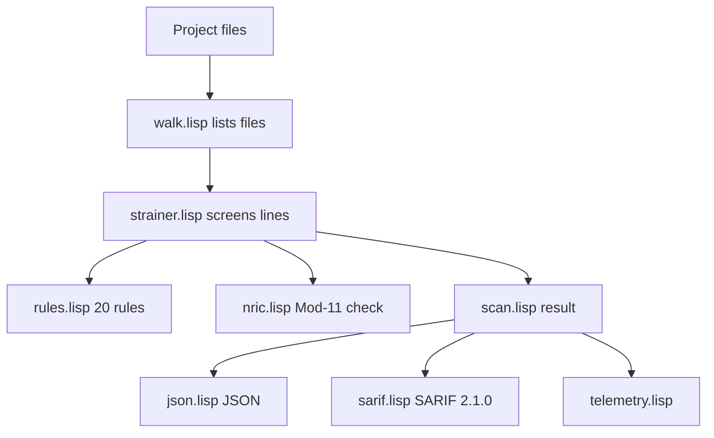

# pdpa-sg 🇸🇬🛡️

[](https://github.com/nurazhardotcom/pdpa-sg/releases)
[](https://github.com/nurazhardotcom/pdpa-sg/actions)
[](./LICENSE)

`pdpa-sg v0.5.0` · Last verified 2026-11-08 · MIT ©2026 Nur Azhar

> Singapore PDPA compliance toolkit. One runtime: SBCL.

`pdpa-sg` is a Singapore PDPA scanner and compliance pack. The scanner is a
Common Lisp program for SBCL. It uses ASDF only and has no external Lisp
libraries.

[Read the checklist](CHECKLIST.md) · [Browse policy templates](resources/policies/)

---

## 📖 In plain English

**What is this?** A free toolkit for organisations in Singapore. It helps you
find common personal-data risks in a codebase and gives you a manual checklist
and policy templates for the PDPA.

**Why should you care?** The PDPA gives the PDPC power to order changes and to
impose financial penalties. Under PDPA section 48J, the maximum financial
penalty is the higher of S$1 million or 10% of annual Singapore turnover. The
10% cap applies when annual Singapore turnover is above S$10 million. For
smaller organisations, the maximum is S$1 million. See
[PDPA section 48J](https://sso.agc.gov.sg/Act/PDPA2012?ProvIds=pr48J-).

**What does this repo do?**

- Scan files for 20 common PDPA risk patterns.
- Report findings as JSON or SARIF 2.1.0.
- Provide a manual 11-obligation checklist.
- Provide eight policy templates.
- Give AI agents a small, deterministic tool surface.

**What does this repo not do?**

- It does not give legal advice.
- It does not certify compliance.
- It does not redact files.
- It does not tick checklist boxes.
- It does not replace a DPO or a legal review.

---

## 🚀 Quick start

### Prerequisite

| Tool | Why | Install |
|---|---|---|
| **SBCL 2.4 or newer** | Builds and runs the scanner | [sbcl.org](https://www.sbcl.org/) |

No other runtime is needed.

### Build and test

```bash
sbcl --non-interactive --load lisp/test/test.lisp
sbcl --non-interactive --load lisp/build.lisp
```

The test suite prints `TESTS DONE checks=98 tests=15 failures=0` on success.
The build writes `bin/pdpa-sg`. Git ignores this file.

### Scan a project

```bash
./bin/pdpa-sg --target /path/to/project --format json
./bin/pdpa-sg --target /path/to/project --format sarif --out audit.sarif
```

The scanner exits `0` when the scan completes. Findings do not change the exit
code. Read the JSON `clean` field or the finding count to gate CI.

### Use the checklist

1. Open [CHECKLIST.md](CHECKLIST.md).
2. Read each obligation.
3. Run the scanner on the project.
4. Fix findings.
5. Tick each box by hand when the evidence exists.

The scanner does not edit the checklist.

---

## 🔧 Command line

```bash
bin/pdpa-sg --target . --format json
bin/pdpa-sg --target . --format sarif --out audit.sarif
bin/pdpa-sg --target . --config pdpa.json
```

| Option | Meaning |
|---|---|
| `--target`, `-t` | File or directory to scan. Required. |
| `--format` | `json` or `sarif`. Default is `json`. |
| `--out` | Write the payload to a file. |
| `--config` | JSON config with `maxCritical`, `maxHigh`, and `excludes`. |
| `--batch` | Initial telemetry batch size. Default is 256. |
| `--depth` | Inspection depth, 1 or 2. Default is 2. |
| `--velocity` | Target records per second. Default is 20000. |

Exit codes:

| Code | Meaning |
|---|---|
| `0` | Scan completed. Findings do not change this code. |
| `1` | Scan, config, or write error. |
| `2` | Bad usage. |

The saved binary uses the SBCL runtime for `--help` and `--version`. Both print
SBCL information, not the `pdpa-sg` banner. All other flags are handled by the
tool.

### JSON output

The JSON result has these keys:

- `findings`: one object per finding.
- `counts`: counts by severity and rule.
- `clean`: `true` when the scan found nothing.
- `telemetry`: velocity, peak, mean, records, batches, batch size, depth,
  adaptation count, last signal, mesh rebuilds, and degraded flag.

### SARIF output

SARIF output uses version 2.1.0. It contains `driver.rules` and `results`.
GitHub code scanning accepts the file.

### Skip directories

The scanner skips `.git`, `node_modules`, `target`, `out`, and `.cpcache`.
These names are skip rules for target projects. They do not add a runtime to
this repository.

### Config

Example `pdpa.json`:

```json
{
  "maxCritical": 0,
  "maxHigh": 5,
  "excludes": ["vendor/", "generated/"]
}
```

The policy check reads `maxCritical` and `maxHigh`. The scanner reports a policy
failure when a threshold is exceeded.

---

## ⚙️ How it works



1. `walk.lisp` lists files and skips the configured directories.
2. `strainer.lisp` compiles the rule tiers and screens each line.
3. `match.lisp` and `nric.lisp` test the line. `nric.lisp` keeps only NRIC and
   FIN values with a valid Mod-11 check digit.
4. `scan.lisp` builds the result with `findings`, `counts`, `clean`, and
   `telemetry`.
5. `sarif.lisp` writes JSON or SARIF 2.1.0. `cli.lisp` parses flags and sets the
   exit code.

Lines with the `pdpa:ignore` marker are skipped. Use this marker for fictional
test data and documentation examples.

### Rule pack

`lisp/src/rules.lisp` holds 20 rules. The rule families cover:

- NRIC and FIN numbers.
- Email addresses and phone numbers.
- Credentials and API keys.
- Financial and health identifiers.
- PDPA policy gaps.
- Unsafe logging and transfer patterns.

The scanner is line based. It is a fast triage tool, not a full data-flow
analyser.

### Telemetry

The engine uses a mutable CLOS strainer. The strainer holds the predicate set,
the batch size, and the inspection depth. A velocity monitor measures records
per second. After each batch the strainer classifies the velocity:

- A surge doubles the batch and restores full depth.
- A slowdown halves the batch. At the minimum batch size, it also lowers the
  depth by one tier.

The strainer compiles each tier into a function with `compile`. The critical
tier holds critical and high rules. The standard tier holds medium and low
rules. At depth 1 the engine skips the standard tier.

---

## 🧠 How an AI agent should use this repo

1. Read [CHECKLIST.md](CHECKLIST.md) first.
2. Read this README.
3. Run the scanner on the target project.
4. Read the JSON result.
5. Fix findings in the target project.
6. Fill the policy templates by hand.
7. Tick the checklist by hand.

Use these commands:

```bash
sbcl --non-interactive --load lisp/build.lisp
./bin/pdpa-sg --target /path/to/project --format json
```

The scanner reports findings. It does not change target files. Keep the
operator in control of edits.

---

## 📚 What is in this repo

```text
pdpa-sg/
├── README.md
├── CHECKLIST.md
├── ARCHITECTURE.md
├── AGENTS.md
├── AI_DISCLOSURE.md
├── SECURITY.md
├── CHANGELOG.md
├── VERSION
├── LICENSE
├── .github/workflows/ci.yml
├── lisp/
│   ├── build.lisp
│   ├── pdpa-sg.asd
│   ├── src/
│   │   ├── cli.lisp
│   │   ├── config.lisp
│   │   ├── detect.lisp
│   │   ├── json.lisp
│   │   ├── match.lisp
│   │   ├── nric.lisp
│   │   ├── package.lisp
│   │   ├── policy.lisp
│   │   ├── rules.lisp
│   │   ├── sarif.lisp
│   │   ├── scan.lisp
│   │   ├── strainer.lisp
│   │   ├── telemetry.lisp
│   │   ├── text.lisp
│   │   ├── version.lisp
│   │   └── walk.lisp
│   └── test/test.lisp
└── resources/policies/
    ├── PRIVACY_POLICY.template.md
    ├── DPO_CONTACT.template.md
    ├── CONSENT_FORM.template.md
    ├── DATA_BREACH_RESPONSE.template.md
    ├── DATA_TRANSFER_AGREEMENT.template.md
    ├── DPIA.template.md
    ├── RETENTION_SCHEDULE.template.md
    └── SECURITY_HARDENING.template.md
```

`bin/pdpa-sg` is build output. Git ignores it.

---

## ✅ Verify the toolkit

```bash
sbcl --non-interactive --load lisp/test/test.lisp
sbcl --non-interactive --load lisp/build.lisp
mkdir -p /tmp/pdpa-smoke
printf 'No personal data.\n' > /tmp/pdpa-smoke/input.txt
./bin/pdpa-sg --target /tmp/pdpa-smoke --format json
./bin/pdpa-sg --target /tmp/pdpa-smoke --format sarif --out /tmp/pdpa-smoke/audit.sarif
```

Check for legacy files:

```bash
find . -path ./.git -prune -o -type f \
  \( -name '*.clj' -o -name '*.cljc' -o -name '*.cljs' -o -name '*.edn' -o -name 'package.json' \) -print
```

The command must print nothing.

---

## 🌍 Rule version stamp

This repo was last reviewed against **Singapore PDPA as of 21 June 2026**.

- **NRIC authentication:** PDPC requires organisations to stop using full or
  partial NRIC numbers for authentication by 31 December 2026. Identification
  remains permitted under existing collection rules. Collect NRIC only when it
  is needed and lawful. See the
  [PDPC press release of 2 February 2026](https://www.pdpc.gov.sg/media-events/organisations-to-cease-the-use-of-nric-numbers-for-authentication-by-31-december-2026).
- **Transfer Limitation (section 26):** overseas transfers require a comparable
  standard. Recognised mechanisms include APEC CBPR, PRP, EU SCCs, and binding
  corporate rules.
- **Data Breach Notification:** notify the PDPC within 3 calendar days after
  assessment when the breach is notifiable.
- **DPO designation:** every collecting organisation must name a DPO and publish
  a business contact.
- **AI governance:** automated decision-making should align with the Model AI
  Governance Framework. Cover transparency, explainability, and human review.
- **Financial penalty cap:** PDPA section 48J sets the maximum at the higher of
  S$1 million or 10% of annual Singapore turnover. The 10% cap applies when
  annual Singapore turnover is above S$10 million.

The rule stamp is in `lisp/src/version.lisp`. The package version is in
`VERSION`.

---

## 🛠️ Tech stack

- **SBCL 2.4+**: compiler and runtime.
- **ASDF**: system definition and test loading.
- **Common Lisp**: all scanner code.
- **No external Lisp libraries**: the engine uses the SBCL standard library.

---

## 🪪 License

MIT ©2026 Nur Azhar · contact via https://nurazhar.com.

Singapore PDPA references are public regulatory material. This repository is
not legal advice.
